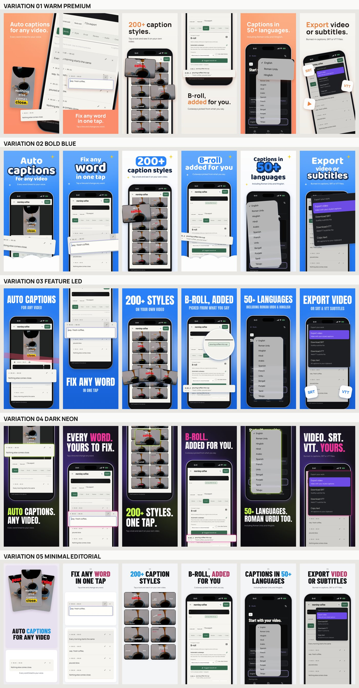
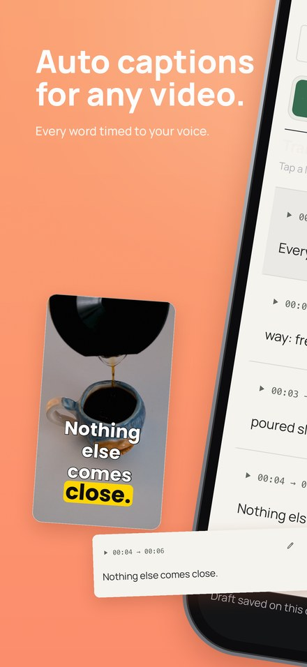
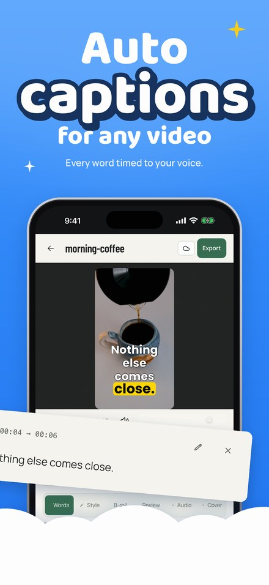
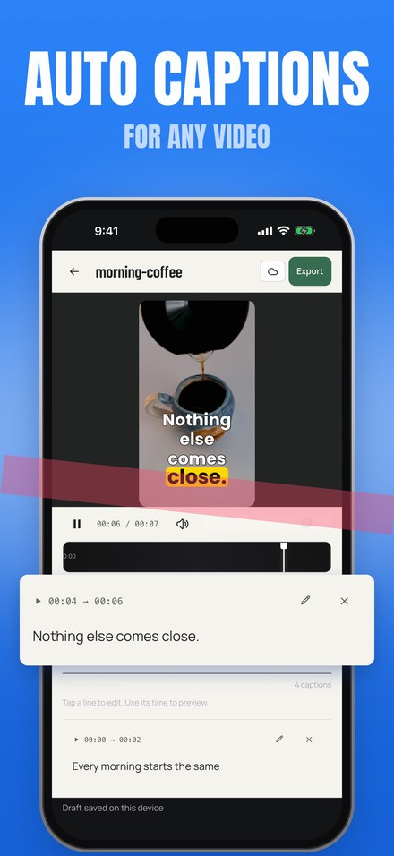
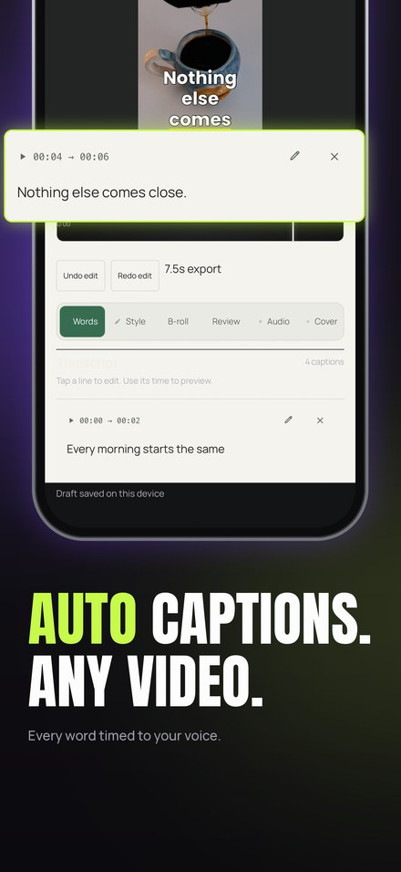
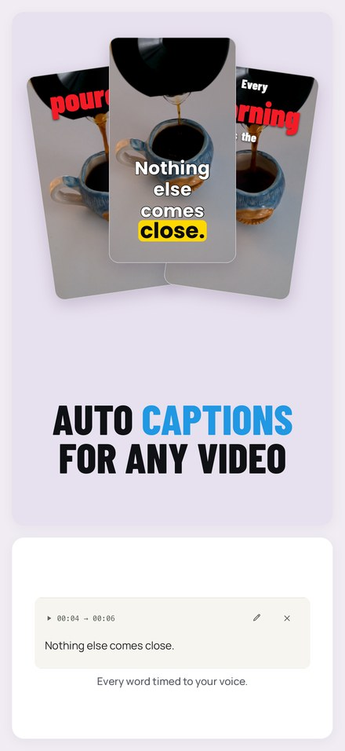

# App Store Screenshot

Reference-driven App Store and Google Play screenshot generator. It turns your app's **real** screens into five complete screenshot sets, each built on a design language reverse-engineered from a professional store listing. It runs as a Claude Code slash command: `/app-store-screenshots`.



## What it does

- **Five independent design styles.** Each one is reverse-engineered from a real reference collection and has its own layouts, type, colour, depth and storytelling. They are not one template with different colours.
- **Uses real UI only.** It crops, enlarges and frames your actual screenshots. It never invents screens or features.
- **Finds existing raw screenshots** in your repo before suggesting a new capture.
- **Simulator capture with permission.** The command asks before it boots a simulator, builds, installs or taps anything.
- **iOS and Android.** It draws generic, logo-free iPhone and Android frames in code and exports at store sizes (iPhone 6.9″ 1320×2868, Play phone 1080×1920 by default, both configurable).
- **Reusable design system.** Includes design tokens, an archetype library, a style decision engine and a QA checklist.
- **Built-in checks.** It verifies size, colour mode and alpha, and the command walks the agent through visually reviewing every image.
- **Content rules in the command itself.** No made-up claims or ratings, no third-party logos, no people, animals or faces, no edits to raw files.

## Style gallery

The images below are real outputs from one app (AutoCaption, the author's own video-captioning app), using the same six screens in all five styles. The source footage is a Pexels stock clip with no people in it.

| | Style | Follows reference | Signature moves |
|---|---|---|---|
|  | **Warm Premium** `warm-premium` | A: couples expense tracker | Coral and cream, sentence-case heavy sans, tiles 1-2 as one panorama with a giant tilted phone, real cards enlarged past the phone, warm shadows |
|  | **Bold Blue** `bold-blue` | B: habit / screen-time app | Blue and white rhythm, rounded display type with sticker and pill words, gold sparkles and a cloud band in place of a mascot, UI breaking the frame |
|  | **Feature-Led** `feature-led` | C: chat export utility | All blue, huge condensed caps plus a qualifier, one demonstration per tile: highlight band, fanned tiles, magnifier lens, format tiles |
|  | **Dark Neon** `dark-neon` | D: dating app (look only) | Purple-black, manifesto caps with full stops, lime and pink alternating, zig-zag text and phone, neon-outlined glowing cards |
|  | **Minimal Editorial** `minimal-editorial` | E: playlist cover maker | Light grey, numbered steps, centred condensed caps, bento cells of real UI, clean bottom-cropped phones |

Full sets: [warm-premium](examples/preview/warm-premium.jpg) · [bold-blue](examples/preview/bold-blue.jpg) · [feature-led](examples/preview/feature-led.jpg) · [dark-neon](examples/preview/dark-neon.jpg) · [minimal-editorial](examples/preview/minimal-editorial.jpg)

The reference screenshots themselves belong to other companies and are **not** included. Only the written analysis is: see [references/](references/).

## Requirements

- macOS or Linux with Python 3.10+ (Pillow, numpy).
- [Claude Code](https://docs.claude.com/en/docs/claude-code), to use the slash command. The Python engine also runs on its own.
- For new captures, optional:
  - iOS: Xcode with an iOS Simulator (`xcrun simctl`).
  - Android: the Android SDK with an emulator system image and `adb`.

## Install

```bash
git clone https://github.com/aariz51/app-store-screenshot ~/app-store-screenshot
cd ~/app-store-screenshot && ./install.sh
```

`install.sh` creates `.venv`, installs the requirements, runs the tests, and copies the command to `~/.claude/commands/app-store-screenshots.md`, so it works in **every** project. To keep the engine somewhere else, set `APPSHOTS_HOME`. More detail: [docs/installation.md](docs/installation.md).

## Use it

In any app repository, open Claude Code and run:

```
/app-store-screenshots
/app-store-screenshots dark-neon iphone
/app-store-screenshots all both
```

The agent:
1. reads the project and writes a feature inventory;
2. finds existing raw screenshots, or **asks** before using a simulator;
3. drafts a storyboard and a `store-assets/project.json`;
4. **asks** which styles and platforms to render;
5. renders, opens every image, fixes problems, and reports.

Using the engine directly:

```bash
cd ~/app-store-screenshot
.venv/bin/python -m appshots discover /path/to/your/app          # find raw screenshots
.venv/bin/python -m appshots init /path/to/your/app/store-assets  # project.json template
.venv/bin/python -m appshots check /path/to/your/app/store-assets/project.json
.venv/bin/python -m appshots render /path/to/your/app/store-assets/project.json --styles dark-neon --platforms iphone
.venv/bin/python -m appshots render /path/to/your/app/store-assets/project.json --styles all
```

See [docs/usage.md](docs/usage.md) and [docs/configuration.md](docs/configuration.md).

## Output

```
store-assets/final/
├── iphone/
│   ├── warm-premium/   screenshot-01.png … screenshot-NN.png, contact-sheet.png
│   ├── bold-blue/ …
│   └── master-comparison.png
└── android/ …
```

Raw screenshots are never changed. Re-running writes only inside the chosen output folder.

## Repository layout

| Path | What |
|---|---|
| `.claude/commands/app-store-screenshots.md` | The slash command |
| `appshots/` | Engine: `engine.py` (devices, shadows, glow, type), `project.py` (config), `styles/` (one module per style), `discover.py`, `validate.py`, `cli.py` |
| `fonts/` | Anton, Barlow Condensed, Manrope, Baloo 2, with their SIL OFL licences |
| `references/` | Reverse-engineering reports, comparative matrix, archetypes and decision engine |
| `design-system/design-tokens.json` | Configurable tokens |
| `templates/` | Project, storyboard and app-analysis templates, QA checklist |
| `docs/` | Installation, usage, configuration, styles, capture, architecture, troubleshooting |
| `examples/` | Example project config and gallery previews |
| `tests/` | Smoke tests on synthetic fixture screens |

## Limitations

- It is **not** fully automatic, on purpose. The agent stops for your approval before simulator or device control, before choosing styles, and before any download or clone.
- Crop boxes for UI callouts come from the agent (or you) measuring real screens. The engine does not detect UI components by itself.
- Copy needs a human eye. Default headline line breaks and accent words are derived automatically, and per-style overrides are available.
- Device frames are generic drawings, not official Apple or Google product images.
- It checks pixel size, colour mode and alpha, not the stores' current upload rules. Check those before you submit.
- Only portrait phone screenshots are supported. iPad and landscape are not supported yet.

## Contributing and licence

See [CONTRIBUTING.md](CONTRIBUTING.md). The code and docs are under the MIT licence ([LICENSE](LICENSE)). The fonts are under the SIL Open Font License ([fonts/](fonts/)). The gallery images show AutoCaption's UI and are included as examples only; the MIT licence does not cover them.
